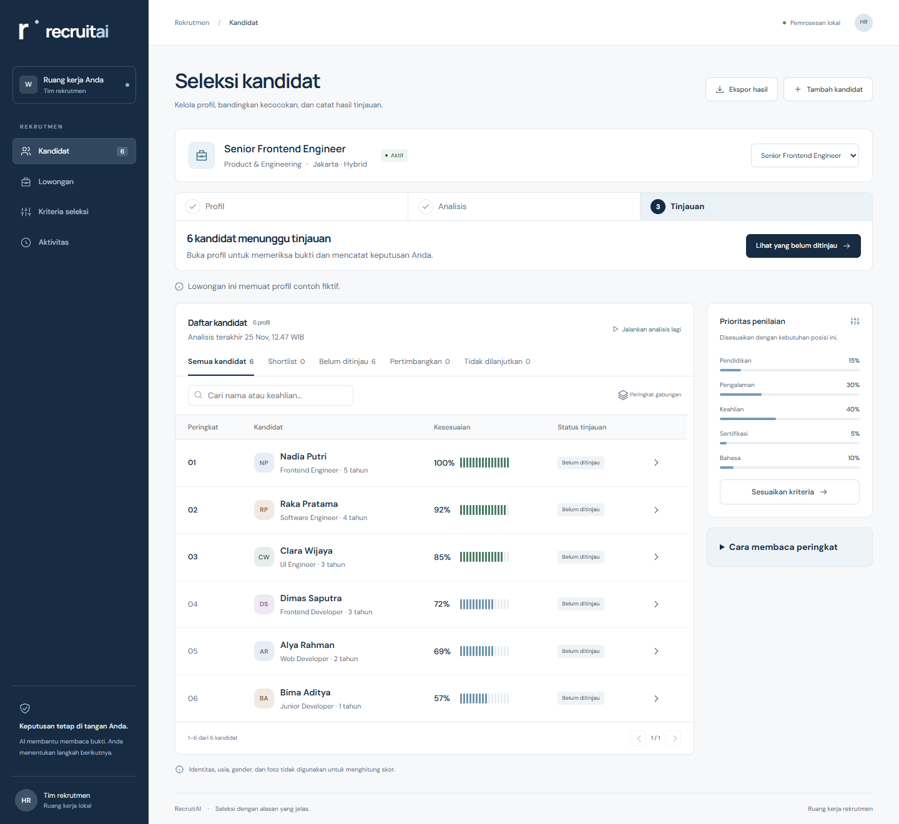

# RecruitAI

RecruitAI is a local-first workspace for recruiters comparing candidates for a specific role. Define the requirements, check the evidence extracted from each résumé, and see how candidates rank under your chosen criteria. The recruiter records the final decision. The interface is in Indonesian.



## Quick start

Install **Python 3.11 or 3.12**, then clone the repository. You can also download and extract the ZIP from GitHub’s **Code** menu.

```sh
git clone https://github.com/gege010/RecruitAI.git
cd RecruitAI
```

On **Windows**, double-click **Start RecruitAI.cmd** in the repository folder. On **macOS or Linux**, run the launcher with your supported Python interpreter.

```sh
python3 run_local.py
```

The launcher creates a virtual environment and installs dependencies on the first run, which requires an internet connection. Open [the local workspace](http://127.0.0.1:8000) and select **Jelajahi data contoh** to explore six fictional profiles. Choose **Buat lowongan pertama** to start with your own vacancy. Local screening works offline after setup. Press **Ctrl+C** in the terminal to stop the server.

## Screen a vacancy

1. **Define the role.** Set requirements and weights for skills, experience, education, certifications, and languages.
2. **Check the profiles.** Upload text-based PDFs of up to 10 MB and 20 pages each. Verify the extracted fields and correct them before analysis. Use manual entry for scanned résumés.
3. **Compare candidates.** Run the analysis with at least two profiles. The fit score shows how much of the role’s requirements the profile satisfies. The relative ranking combines SAW, Weighted Product, and TOPSIS using Borda aggregation.
4. **Record a decision.** Review the evidence, then shortlist, place on hold, or decline. A decline requires a note.
5. **Export a snapshot.** Download the analysis as CSV. Run the analysis again to include subsequent edits or review decisions in the export.

## Data and deployment

The default SQLite database at `var/recruitai.sqlite3` stores structured profiles, review notes, and analysis snapshots. The application processes uploaded PDFs temporarily. Optional Groq-assisted extraction sends résumé text to Groq when the operator enables the integration and the recruiter selects it for an upload. See the [configuration example](.env.example).

The local launcher binds to the loopback interface. Shared deployments use a single workspace password for one trusted HR team. Before handling real candidate data on a shared server, configure HTTPS, backups, access, and retention using the [operations guide](docs/OPERATIONS.md).

## Development

FastAPI serves the [Python API](server/) and the [HTML, CSS, and JavaScript interface](web/). The [ranking methods](core/mcdm/) are implemented separately. With the project virtual environment active, run the Python checks below.

```sh
python -m pip install -r requirements-dev.txt
python -m pytest -q
python -m ruff check run_local.py server tests core/mcdm
python -m ruff format --check run_local.py server tests core/mcdm
```

For frontend checks, use Node.js 22 and run `npm ci`, `npm run check`, and `npm run format:check`. The browser suite creates and edits fictional profiles. Follow the [CI workflow](.github/workflows/checks.yml) to run it with Chromium and a dedicated test database.

## Help and contributions

Maintained in the [gege010 GitHub account](https://github.com/gege010). To report a problem, [open an issue](https://github.com/gege010/RecruitAI/issues) with reproduction steps, your operating system and Python version, and the expected and observed behavior. Use fictional candidate data in reports and screenshots. For a code change, run the relevant checks and describe the behavior you verified in your pull request.

- [Product contract](PRODUCT.md) — scoring, review decisions, and data boundaries.
- [Design system](DESIGN.md) — interface patterns and accessibility.
- [Verification notes](docs/VERIFICATION.md) — test coverage and limitations.
- [Original prototype](docs/LEGACY-README.md) — project history and academic credits.
