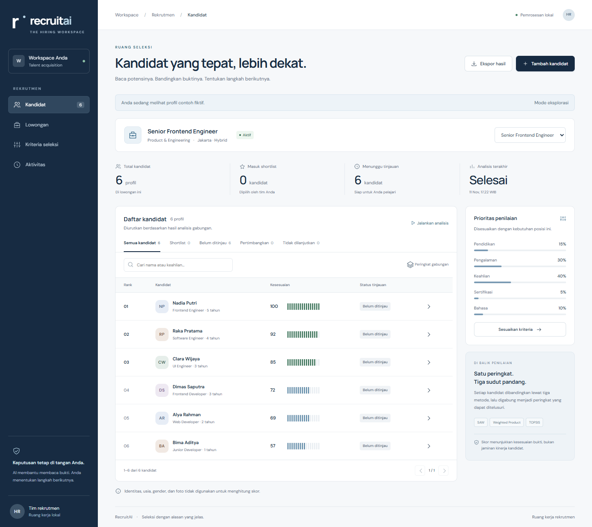

# RecruitAI

RecruitAI membantu tim HR membandingkan kandidat untuk satu lowongan. Tim
menetapkan kriteria, memeriksa profil dari CV, lalu melihat bukti di balik skor
sebelum mencatat keputusan. Ruang kerja berjalan di browser dan menyimpan data
di SQLite pada mesin yang menjalankannya.



## Mulai

Pasang **Python 3.11 atau 3.12**. Clone repositori atau unduh dan ekstrak ZIP
dari menu **Code** di GitHub.

```sh
git clone https://github.com/gege010/RecruitAI.git
cd RecruitAI
```

**Windows** (PowerShell)

```powershell
py -3.11 -m venv .venv
.\.venv\Scripts\python.exe -m pip install -r requirements.txt
.\.venv\Scripts\python.exe -m uvicorn server.main:app --host 127.0.0.1 --port 8000
```

**macOS dan Linux**

```sh
python3 -m venv .venv
.venv/bin/python -m pip install -r requirements.txt
.venv/bin/python -m uvicorn server.main:app --host 127.0.0.1 --port 8000
```

Jika memakai Python 3.12 di Windows, ganti `py -3.11` dengan `py -3.12`.

Setelah server berjalan, buka [127.0.0.1:8000](http://127.0.0.1:8000).
Pilih **Jelajahi data contoh** untuk mencoba alur seleksi dengan enam profil
fiktif, atau **Buat lowongan pertama** untuk mulai dari ruang kerja kosong.

Internet diperlukan saat memasang dependensi. Setelah itu, pemrosesan lokal
bisa berjalan offline tanpa akun, API key, Node.js, atau Docker. Tekan
**Ctrl+C** untuk menghentikan server.

## Alur seleksi

1. **Buat lowongan.** Isi persyaratan keahlian, pengalaman, pendidikan,
   sertifikasi, dan bahasa. Atur bobot sesuai kebutuhan posisi.
2. **Tambahkan dan periksa profil.** Unggah PDF berbasis teks hingga 10 MB dan
   20 halaman, atau masukkan profil secara manual. Untuk CV hasil pindai,
   gunakan input manual.
3. **Jalankan analisis.** Tambahkan minimal dua kandidat untuk membandingkan
   peringkat. Skor persentase menunjukkan tingkat pemenuhan persyaratan posisi.
4. **Tinjau bukti dan catat keputusan.** Pilih shortlist, pertimbangkan, atau
   tidak dilanjutkan. Keputusan tidak dilanjutkan memerlukan catatan.
5. **Ekspor CSV.** Ekspor memakai skor dan status dari snapshot analisis.
   Jalankan ulang analisis untuk memperbarui snapshot setelah profil, kriteria,
   atau status tinjauan berubah.

## Data dan penggunaan tim

Database default berada di `var/recruitai.sqlite3`. Aplikasi menyimpan profil
terstruktur, catatan tinjauan, dan snapshot analisis. File PDF asli diproses
sementara. Jika tim mengaktifkan Groq, teks CV dikirim ke layanan tersebut hanya
saat pengguna memilih bantuan AI pada unggahan. Lihat [`.env.example`](.env.example)
untuk pengaturan opsional.

Deploy bersama ditujukan untuk satu organisasi dan satu tim HR dengan kata
sandi bersama. Untuk konfigurasi HTTPS, cadangan, dan retensi sebelum memakai
data kandidat nyata, ikuti [panduan operasional](docs/OPERATIONS.md).

## Pengembangan

FastAPI menyajikan API dan antarmuka HTML, CSS, serta JavaScript. Kode aplikasi
ada di [`server/`](server/) dan [`web/`](web/). Metode SAW, Weighted Product,
TOPSIS, dan agregasi Borda ada di [`core/mcdm/`](core/mcdm/).

Aktifkan `.venv`, lalu jalankan pemeriksaan Python:

```sh
python -m pip install -r requirements-dev.txt
python -m pytest -q
python -m ruff check server tests core/mcdm
python -m ruff format --check server tests core/mcdm
```

Pemeriksaan frontend memerlukan Node.js. Jalankan `npm ci`, `npm run check`,
dan `npm run format:check`. Untuk pengujian Playwright, gunakan Chromium dan
server dengan database uji kosong di port 8001. Perintah lengkap tersedia di
[workflow CI](.github/workflows/checks.yml).

## Kontribusi

Untuk melaporkan bug, buka [issue](https://github.com/gege010/RecruitAI/issues)
dengan langkah reproduksi, sistem operasi, versi Python, dan hasil yang
diharapkan. Gunakan profil fiktif pada contoh dan tangkapan layar. Untuk
perubahan kode, jalankan pemeriksaan yang relevan sebelum membuka pull request.

## Dokumentasi

- [Kontrak produk](PRODUCT.md) menjelaskan cara membaca skor, batas otorisasi, dan penyimpanan data.
- [Sistem desain](DESIGN.md) mendokumentasikan pola antarmuka dan aksesibilitas.
- [Catatan verifikasi](docs/VERIFICATION.md) mencatat hasil pengujian dan cakupannya.
- [Prototipe awal](docs/LEGACY-README.md) menyimpan dokumentasi dan atribusi proyek kuliah.
